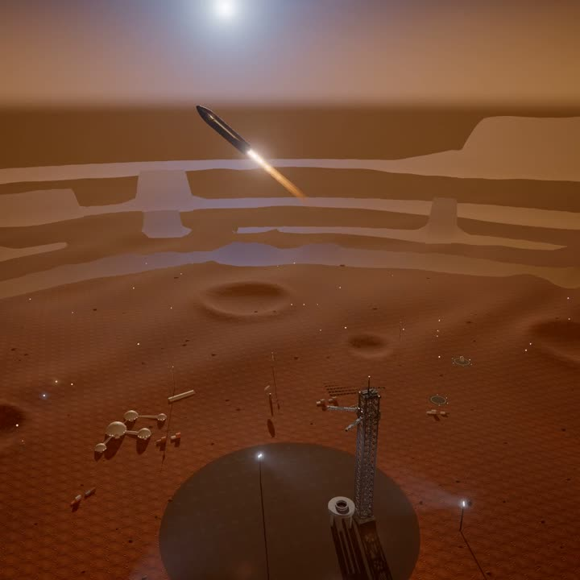
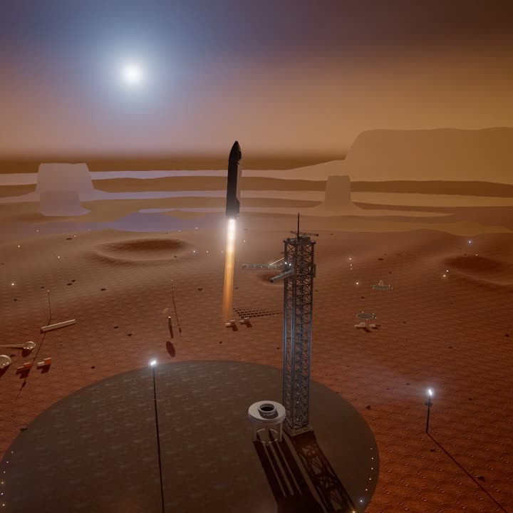
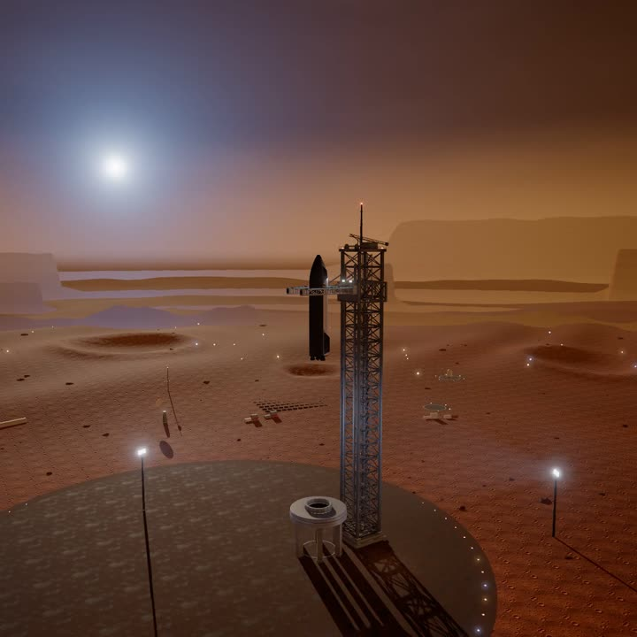

# ShipFall

A 3D browser game: steer a falling rocket booster or ship into the tower's catch arms, and close them at the right moment. Playable inside an X post.

**[Play at shipfall.vercel.app](https://shipfall.vercel.app)**

[](https://shipfall.vercel.app)

Built with [three.js](https://threejs.org) and Vite. Static site plus one Vercel Function for the worldwide leaderboard. Not affiliated with SpaceX.

**Ship catch replay** (Explore → Ship catch): [watch the clip](docs/media/shipfall-catch.mp4)

| Belly flop | Flip and burn | Caught |
| --- | --- | --- |
|  |  |  |

## Play it inside an X post

The site ships a `twitter:card=player` card. Post a link to `/` (the share page) and x.com plays `/embed/` (the game-only page, designed for 480×480) in a frame inside the post. X's phone apps show the card image with a play button and open the game in the in-app browser. DMs and the composer show no player, so test with a real post.

X caches a card for about seven days, so post a fresh address each time the card changes, e.g. `https://shipfall.vercel.app/?v=10`.

## Modes

| Mode | What you do |
| --- | --- |
| **Catch** | Pick **ShipFall** (booster or ship, a new one each round), **Ship only** or **Booster only**. At 3,000 pts **double catch** unlocks: a second tower, a booster and a ship each round. |
| **Mission** | Fly the full stack to orbit, deploy satellites, then land the ship back at the tower. |
| **Explore** | Orbit around the stack on the launch mount. Chips fly to each part; **Ship catch** replays a ship catch from an aerial corner camera, with a **Ground view** chip. |

Scores go to a worldwide leaderboard by X @handle (handles aren't verified).

## Controls

| Action | Keyboard | Touch |
| --- | --- | --- |
| Side thrusters (Catch) / pitch (Mission) | `←` `→` or `A` `D` | ◀ ▶ |
| Catch arms (Catch) / throttle (Mission) | `↑` `↓` or `W` `S` | ▲ ▼ |
| Close arms (Catch) / stage, deploy, flip (Mission) | `Space` | CATCH / ACTION |
| Start | `Enter` | Play |
| Pause | `P` / `Esc` | pause button |
| Sound | `M` | speaker button |
| Explore | drag to orbit, scroll to zoom, right-drag to pan, `1`–`9` for parts | drag, pinch, two-finger pan |

## Maps

**Mars** (default): a dusk regolith plain with mesas, Phobos and Deimos, and a small base. **Starbase**: the night launch site. Maps change only the scenery; physics and scoring are identical. `?map=mars|starbase` picks one from a link.

## Run locally

Node 20.11+.

```bash
npm install
npm run dev      # Vite dev server (game-only page at /embed/)
npm test         # simulation, flight and leaderboard API tests
npm run build    # static site -> dist/
```

## Deploy

Vercel picks up `vercel.json` (build command, `dist/` output, frame-ancestors headers for X, `trailingSlash`). Set these environment variables:

| Variable | Purpose |
| --- | --- |
| `VITE_SITE_URL` | Public https origin, no trailing slash (e.g. `https://shipfall.vercel.app`). All card URLs come from it. |
| `VITE_SHARE_POST` | Optional. A launch post on X that **Post on X** quotes instead of linking the site. |
| `KV_REST_API_URL`, `KV_REST_API_TOKEN` | Set by Vercel's Upstash for Redis integration (Storage → Upstash for Redis, free tier). Powers `api/leaderboard.js`; without it the API returns 503 and the game shows an on-device board. |

After deploying, post a fresh `/?v=N` link to check the card.

## Scripts worth knowing

| Command | What it does |
| --- | --- |
| `npm run check:card` | Builds, serves `dist/` and checks meta tags, card images, headers and the JS budget. Run with `VITE_SITE_URL` set. |
| `npm run card` | Re-renders `public/player.jpg` and `public/share.jpg` from the real scene. `CARD_SCENE=ship\|stack`, `CARD_MAP=mars\|starbase`, `CHROMIUM_CHANNEL=chrome` to use installed Chrome. |
| `npm run record` | Records the deterministic `?demo=1` showcase to MP4/GIF in `artifacts/` (needs `npx playwright install chromium` once). |
| `npm run record:embed` | Records `/embed/` inside a 480×480 iframe host page, sandboxed like X's. |
| `npm run author-demo` | Regenerates the demo's input script; `-- --check` re-verifies it. |

## Credits

- Fonts: D-DIN (Datto) and Sedgwick Ave Display, both SIL Open Font License; licenses in [`public/licenses/`](public/licenses/).
- [three.js](https://threejs.org): MIT.
- 3D models: built by the Blender script in [`blender/`](blender/), no third-party assets. Textures and sky are procedural.

**Not affiliated with SpaceX.** No logos, trademarks or official imagery.
