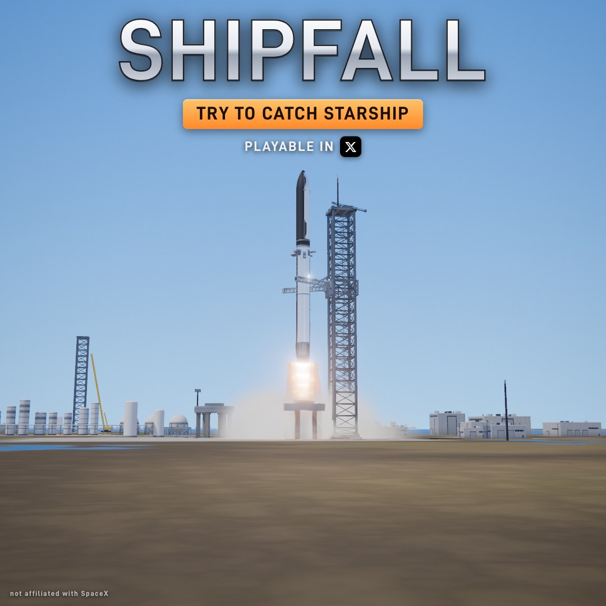
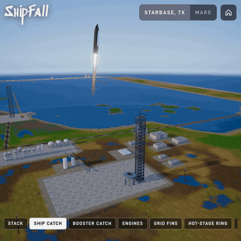

# ShipFall

Catch a falling Starship with the tower's arms. A 3D browser game you can play right inside an X post.

**[Play at shipfall.vercel.app](https://shipfall.vercel.app)**

[](https://shipfall.vercel.app)



Watch with sound: [ship catch at Starbase, TX](docs/media/shipfall-catch-starbase.mp4) · [booster catch on Mars](docs/media/shipfall-catch-mars.mp4)

## How to play

Steer the falling ship or booster over the tower, line the arms up with its pins, and close them gently.

| | Keyboard | Touch |
| --- | --- | --- |
| Steer | `←` `→` | ◀ ▶ |
| Arms | `↑` `↓` | ▲ ▼ |
| Catch | `Space` | CATCH |

**Catch** the ship, the booster, or both. **Mission** flies the full stack to orbit and back. **Simulate** walks around the stack and replays catches. Scores go on a worldwide leaderboard by X handle.

## Run locally

```bash
npm install
npm run dev
```

## Credits

Built with [three.js](https://threejs.org). Fonts: D-DIN and Sedgwick Ave Display (SIL Open Font License). All models are original.

**Not affiliated with SpaceX.**
